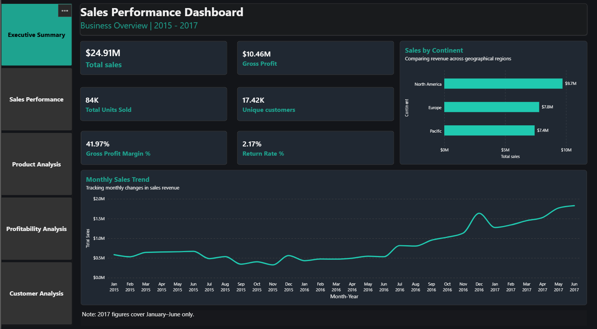
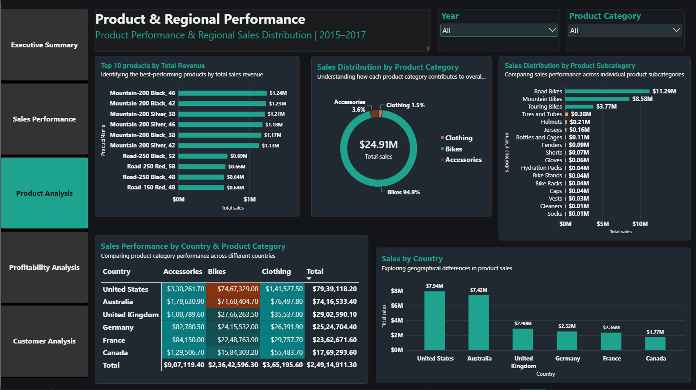
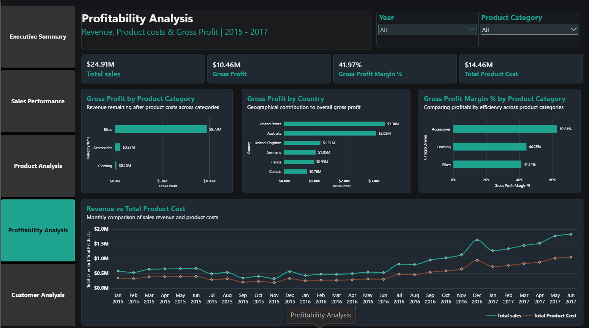
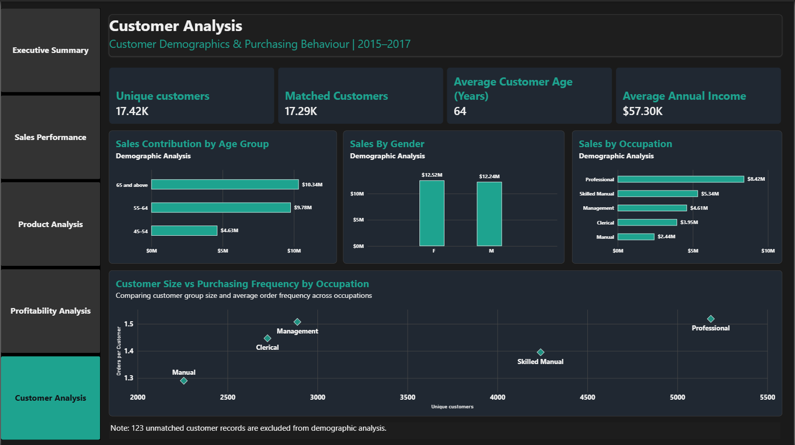

# Sales Performance & Business Insights Dashboard | Power BI

## Project Overview

This project involves developing an interactive Power BI dashboard to analyse business sales performance, profitability, product performance, regional trends and customer demographics.

The objective is to transform raw business data into meaningful insights through data modelling, DAX calculations and interactive visualisations.

## Business Objectives

- Monitor overall sales performance and trends.
- Evaluate product category and regional performance.
- Analyse gross profit and profit margins.
- Understand customer demographics and purchasing patterns.
- Support data-driven business decision-making.

## Tools & Technologies

- Microsoft Power BI
- Power Query
- DAX (Data Analysis Expressions)
- Data Modelling
- Data Visualisation

## Dashboard Overview

### 1. Executive Summary

Provides an overview of key business performance indicators.

### 2. Sales Overview

Examines sales performance and trends over time.

### 3. Product & Regional Analysis

Evaluates product category, subcategory and geographical sales performance.

### 4. Profitability Analysis

Examines gross profit, product costs and profit margins.

### 5. Customer Analysis

Explores customer demographics and purchasing behaviour.

## Technical Implementation

- Data cleaning and transformation using Power Query.
- Data modelling and relationships across multiple tables.
- DAX measures for total sales, gross profit and gross profit margin.
- Calculation of sales growth and return rate.
- Interactive slicers and report navigation.
- Bookmarks and interactive visual elements.

## Key Learning Outcomes

- Practical experience in business intelligence and reporting.
- Understanding of data modelling and DAX.
- Applying financial and business performance measures.
- Presenting analytical information through interactive dashboards.
- Translating business data into meaningful visual insights.

## Project Files

- Dashboard screenshots.
- Power BI report file (.pbix), subject to dataset sharing permissions.

## Disclaimer

This project was developed for learning and portfolio demonstration purposes. Dataset ownership and usage are subject to the original data provider's terms.
